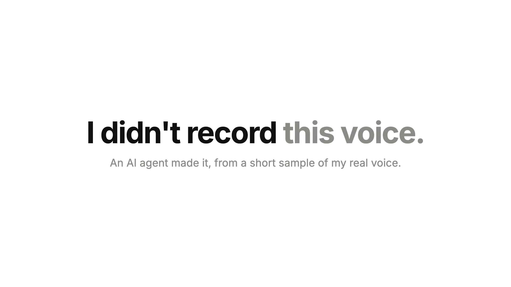

# 🎬 ciak

**The screen recorder your agent edits.**

*Ciak, si gira!* is what Italian film crews say when the camera rolls. ciak records your
screen, then hands the editing to an agent: cutting dead air, zooms on clicks, captions,
titles, narration, the final export. You watch the result and say "ok" or "redo".

[](https://nicoloboschi.github.io/ciak/)

▶ **[Watch the launch video](https://nicoloboschi.github.io/ciak/)**: an agent recorded, edited and
rendered it with ciak, narrated in my own cloned voice.

## Why

Video editors hide every decision behind a timeline. An agent can't use a timeline, and when
the app gets something wrong (Recordly dropped the voice from the export) you can't see why.
In ciak every edit is a plain file and a command:

- **Files, not state.** Each recording is a folder with `recording.mp4`, `recording.project.json`
  (cuts, zooms, speed, background), the cursor log and captions. Change the JSON, render again,
  get the same video.
- **One file, one audio track.** Mic and system sound are mixed into the video's only track,
  so the voice never goes missing.
- **Agents first.** Every feature works from the command line and prints JSON. The panel is
  only for what needs a human: recording and review.

## Install

macOS 15+ on Apple silicon. You need Xcode command line tools (`swiftc`), Node 22+, `ffmpeg`
and [`uv`](https://docs.astral.sh/uv/) (for Whisper and the voice model).

```bash
git clone https://github.com/nicoloboschi/ciak && cd ciak
npm install
./ciak app install
```

`ciak app install` sets up, once:
- **ciak.app** in the menu bar: ⌘1 framed screenshots, ⌘2 quick recording, Record… opens the panel. Starts at login.
- the `ciak` command in `~/.local/bin`
- the agent skill in `~/.claude/skills/ciak`, so Claude Code (or any agent reading skills) knows every command

The first time, macOS asks for **Screen Recording** (and **Microphone** when you record): allow ciak.

## Use it

### You record, your agent edits

Press ⌘2 (or Record… in the menu bar), record, stop. The panel opens on the new project with
its id. Then tell your agent:

> Use /ciak to edit project 3f9a1c2e: cut the pauses, zoom less at 0:20, make it vertical.

The panel plays the edit live while you flip switches (click sounds, zooms, mic, camera, speed)
and shows the exported file with **Copy**, ready to paste in a chat.

### Your agent records itself

```bash
ciak record browser https://app.example.com --name demo   # a second Brave with your logins, recorded in the background
ciak record look                                  # the page's buttons, links and fields, numbered
ciak record click 12                              # or type / wait / scroll / select / drag…: the mouse glides
ciak record stop                                  # auto-edit: idle time cut, zooms on every click
ciak project render demo                          # → ~/Documents/ciak/demo-<id>.mp4, checked
```

A terminal works the same way (`ciak record terminal`, then `ciak record run "<cmd>"`), with secrets blurred.

Five words cover everything: `ciak record`, `ciak project`, `ciak shot`, `ciak voice`, `ciak app`.
`ciak <word> help` shows each one.

### Edit with commands

```bash
ciak project edit <id> --cut-idle --auto-zoom          # or --cut-silence, --cut 3,7
ciak project edit <id> --speed 1.5                     # or one part: --speed 3,12,40
ciak project edit <id> --background sunset --preset vertical
ciak project edit <id> --mic off --clicks off --camera round=off,size=0.3,position=top-left
ciak project captions <id>                             # local Whisper: .srt and word timestamps
ciak project preview <id> --frame 90                   # one frame as PNG
ciak project render <id>
```

### Launch videos

A film is a project too: one `film.json` of scenes (title, recording, stats, chart, compare, custom React…),
narrated from each scene's `say`:

```bash
ciak voice add me                              # read 15 seconds aloud: your cloned voice, local
ciak project new launch --with demo            # a film that starts with your recording
ciak project live launch                       # play it in the browser, reloads on save
ciak project render launch                     # final mp4 + .srt + a check of what a viewer would notice
```

`ciak project schema` describes every field. The check lists text off-frame, low contrast, frozen
recordings, music over the voice and words a listener would mishear, each with a time and a frame.

### Screenshots

⌘1: pick an area or a window, it lands on a wallpaper with rounded corners and a shadow,
copied and saved to `~/Documents/ciak/shots`. From the command line: `ciak shot`.

## Where things live

| What | Where |
| --- | --- |
| Projects (raw recording, edit JSON, cursor log, captions) | `~/.ciak/projects/<id>/` |
| Finished videos and screenshots | `~/Documents/ciak/` (`CIAK_DIR`) |
| Cloned voices, styles, trace log | `~/.ciak/` |
| The ciak browser profile | `~/Library/Application Support/ciak/browser` |

Every ciak process writes what it does, with times, to `~/.ciak/trace.log`.
`ciak help` lists every command and option.

## Features

Status: ✅ done and tested · 🧪 built, not yet tested · ⬜ not started

### Record

- ✅ Screen + cursor + mic into **one** mp4 with a single audio track (ScreenCaptureKit)
- ✅ Pick the display (`--display <index>`)
- ✅ Stop with Enter or Ctrl-C; file is finalized cleanly
- ✅ Background recording for agents: `start` / `pause` / `resume` / `stop`, pauses leave no gap
- ✅ If the recorder crashes, the recording so far is kept and the session pauses
- ✅ Action marks (`ciak record mark`, `--at` or `--page`) to drive zooms when the real mouse doesn't move
- ✅ Logged-in browser for agents (`ciak record browser`), recorded while covered, page clicks/typing logged
- ✅ Reading the page (`ciak record look`: buttons, links and fields, numbered for `click 12`), `wait` for text, `hover`, `select`, `drag`, `upload`, `back`/`forward`
- ✅ Drive it from the command line: `browser click/type/paste/key/scroll/go/eval/shot`
- 🧪 Looks like a person: the mouse bows and slows into its target (longer moves take longer), typing has an uneven rhythm and replaces the field's text, long text is pasted
- ✅ Browser sound in browser recordings (`--system-audio`: only the ciak browser, not other apps) · 🧪 `--mic`
- ✅ Sharp: the ciak browser draws at 2x even on a non-Retina monitor
- ✅ 60 fps by default (`--fps 30` for smaller files), kept through the render
- 🧪 Log cursor position and clicks to `<name>.cursor.jsonl` (file written; clicks not yet checked)
- ✅ Optional system audio, mixed into the same track (never a second track)
- ✅ Record a single window (only while visible) or a region
- ✅ Optional webcam bubble · ✅ round or a rounded rectangle, size and corner (`edit --camera round=off,size=0.3,position=top-left`) · ✅ the same in the panel, under the video
- ✅ Mic, Mac sound and webcam each on or off in the video afterwards (`edit --mic off`, the panel's "In the video"): the recorder also saves the mic and the Mac sound apart
- ✅ Panel feel (after recent.design): a rounded arrow cursor (black, white in dark mode), quiet click tones made in the page (a tap on press, rising/falling on a switch), springy presses and hovers
- ✅ Speed: the whole video (`edit --speed 1.5`, the panel's Speed menu, shown at once in the live preview) or one part (`edit --speed 3,12,40`); the voice keeps its pitch
- ✅ Click sounds and zooms on or off too (`edit --clicks off`, `--zooms off`, same panel card)
- ✅ Live preview in the panel: the edit plays in the page (30 fps, Remotion player), a switch or camera change shows at once without a render · ✅ the exported file's name with Copy (the video file on the clipboard, paste it in a chat) and Show in Finder
- 🧪 Stop from macOS's menu bar recording icon finishes the recording (not tried with the real icon yet)
- ✅ An ultrawide screen keeps its shape in the video (2560×1080), instead of being squeezed small into 16:9
- ✅ Menu bar app (`ciak app install`): ⌘1 screenshots, Record… (the recording panel), Open Recordings; starts at login and holds the permissions
- ✅ Panel (`ciak app panel`, menu bar Record…): projects (recordings and films) on the left (thumbnail, time, length, state); a new recording with live camera preview and mic meter; after Finish every step (stop, encode + mix, clicks, auto edit, render frames with a live count, audio, check) with its timing, then the video and the project id with a prompt for your agent. It follows an agent's renders live. Rename or delete a project there (`ciak project rename|remove`; delete goes to the Trash)
- ✅ Quick recording (⌘2): the screenshot overlay picks an area or a window, a red frame and timer show while it records (default mic); ⌘2 or a click on the timer stops it, the panel opens on the project and renders it. The picker stays loaded between uses, so the overlay opens at once
- ✅ Panel: Screenshots page (⌘1 shots, newest first: open, copy, show in Finder, delete to the Trash; `ciak shot list|copy|remove`)
- ✅ Panel: Voices page: every cloned voice with its sample and a Try-it box; add one by reading a text in the page or uploading a voice note or video; a failed try keeps the old voice
- ✅ An agent with only the skill edits a project by id ("Use /ciak to edit project <id>: make it vertical, sunset background") — tested with a fresh agent
- ✅ Projects by id: raw files in `~/.ciak/projects/<id>/`, every command takes the id (or the name)
- ✅ Recordings follow the screen: they used to freeze on the first picture (macOS ran out of frame slots)
- ⬜ Menu-bar indicator while recording (so you know it's on)
- 🧪 Pick the mic by name (`--mic "Brio 100"`)
- 🧪 Mic level check before recording starts (meter in the panel)

### Understand

- ✅ Local transcript with word timestamps (`ciak project captions`, Whisper on Apple silicon)
- ⬜ Scene/screen-change detection (what's on screen when)
- ✅ One `<name>.project.json` that gathers everything an agent needs:
  video, transcript, cursor log, marks, edit decisions

### Edit (agents)

- 🧪 Cut silences, driven by the audio (`--cut-silence`)
- ✅ Cut idle time: still picture, no voice, no clicks or typing (`--cut-idle`, for agent recordings)
- ⬜ Cut filler words, driven by the transcript
- ⬜ Cut by text: delete a sentence from the transcript, it's gone from the video
- ✅ Auto-zoom on marks; close actions pan instead of zooming out and in; gentle (≤ 1.3x) and it lets go between actions over 2.5 s apart
- ✅ Auto-zoom on clicks in the ciak browser · 🧪 on real mouse clicks
- ⬜ Smooth pan following the cursor while zoomed
- ✅ Smooth / enlarged cursor drawn on top, gliding onto each click
- ✅ Click sounds: a soft tick on each click (`audio.clicks` in the project, on by default); films have none unless `"clicks": true`
- ✅ Screenshots like Cap: `ciak shot` (drag a region or press space for a window) puts it on a wallpaper with rounded corners and a shadow, saves it to `shots/`, copies it; ⌘1 in the menu bar app: instant native picker with a glowing border, shutter sound, then Finder shows the file
- ✅ Background (wallpaper gradients: `--background aurora|sunset|ocean|meadow|graphite`, or any CSS), padding, rounded corners, shadow
- 🧪 Burned-in captions with a clean style
- 🧪 Intro/outro title cards (`intro` / `outro` in the project)
- 🧪 Loudness normalization for the voice; ✅ a mic with nobody talking is left quiet instead of lifted (key presses no longer become thumps)
- ✅ No mic unless asked (`--mic default`, the panel's Microphone, quick recordings have none)
- ✅ Mic background noise removed automatically (`lib/clean.mjs`: level, then DeepFilterNet), for recordings and the cloned voice's sample: a built-in-mic recording went from 10 dB to 47 dB between voice and pauses
- ✅ Rendering via Remotion, so every edit is code an agent can change

### Films (launch videos)

- ✅ Films (`ciak project new`, then `ciak project render`): scenes (title, stats, image, slide, chart, recording, before/after compare) → one video
- ✅ Narration from each scene's `say` (local Kokoro voice, macOS `say` fallback), scenes stretch to fit it
- 🧪 Your own voice: `ciak voice add me` records a 15 s sample, films with `"voice": {"name": "me"}` are cloned with Qwen3-TTS (tested with a sample voice, not yet a real one)
- ✅ Captions timed per sentence, burned in and written as `.srt`
- ✅ Background music (generated, or your file), ducked under the voice
- ✅ `--preview`: one contact-sheet image of every scene in ~30 s
- ✅ Recordings auto-edit on stop (idle cut, zooms) and are referenced by `--name` · ✅ `--no-zoom` skips the zooms (🧪 the panel's "Zoom on clicks" box, on by default)
- ✅ Keynote look: light theme, two-tone headlines (`*muted*`, `[accent]`), word-by-word reveals
- ✅ Footage or stills behind any scene; chips, pills and counters on title scenes
- ✅ Animated line charts (dashed projections, end labels, side-by-side panels) and an end card
- ✅ One-step page capture: `start --browser --url <page> --run "play()" --for 8 --name x`
- ✅ Schema for film.json (`ciak project schema`): one vocabulary, typo suggestions, exact error paths
- ✅ Custom scenes: any layout as a React component in the film folder (`"type": "custom"`), with ciak's building blocks
- ✅ Film styles (`"style": "hindsight"`, `ciak project styles`): fonts, colors, surfaces, radius, backdrop; built-in or your own
- ✅ Live preview in the browser (`film --live`): plays with sound, reloads when files change
- ✅ Frame by frame (`ciak project frames`): labelled frames of a scene or time range, before export
- ✅ Terminal recordings: `terminal open` + `start --terminal` + `terminal run "<cmd>"` (real shell, secrets masked)
- ✅ The check after every render (`ciak project check`): layout, contrast, jumps, flashes, frozen recordings (also a recording that ends before its scene),
  voice vs music, misheard words, caption speed — each with a time and a frame

### Export

- ✅ `ciak project render <id>` → final mp4 (1080p: about 1.3 s of work per second at 30 fps, 2.3 s at 60 fps)
- ✅ Small files: raw recordings ~20 MB/min, final videos ~30 MB/min at 1080p60 (x264, visually lossless)
- ✅ Preset 16:9 · 🧪 9:16 and square (`--preset vertical|square`) · ⬜ GIF
- ✅ Check the output before calling it done (one video + one audio track, right length)

### Agent workflow

- 🧪 Claude Code skill: record a task / edit a recording end to end (`.claude/skills/ciak`)
- 🧪 Feedback loop: you say "zoom less at 1:20", the agent edits the project JSON and re-renders
- ⬜ Watch folder: new recordings are processed automatically
